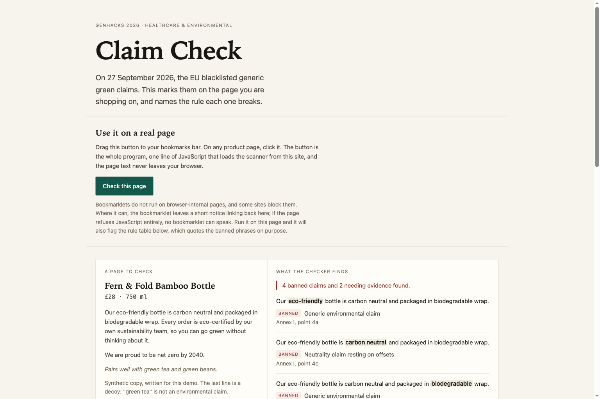
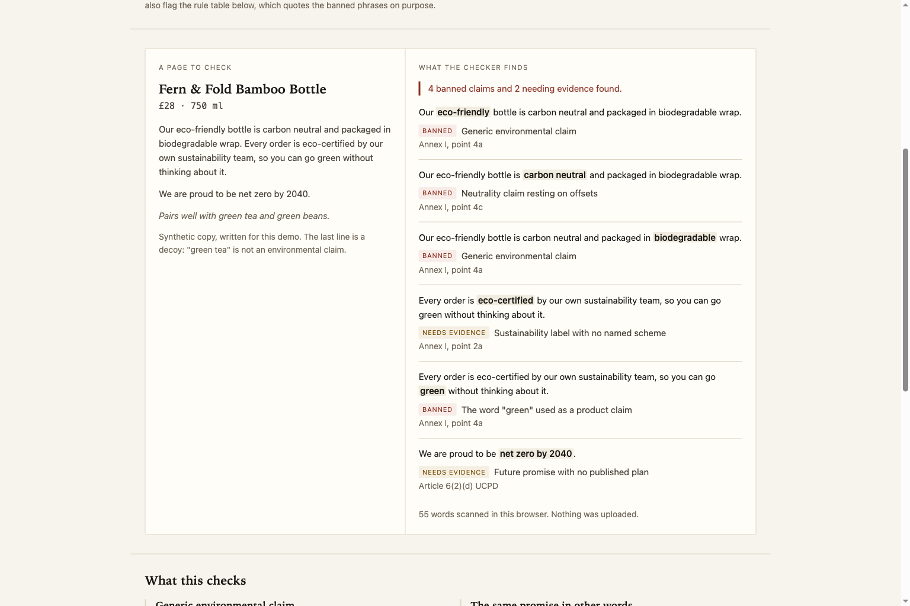
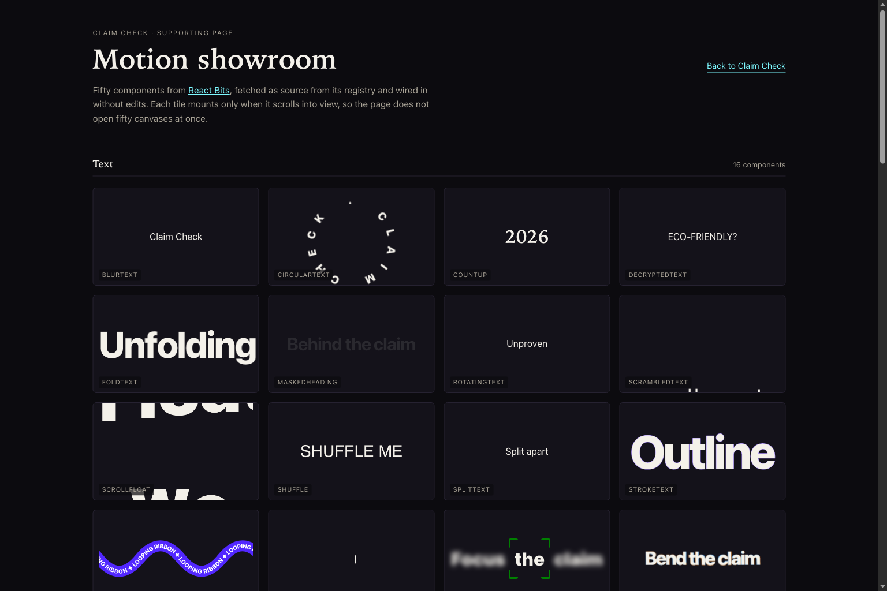
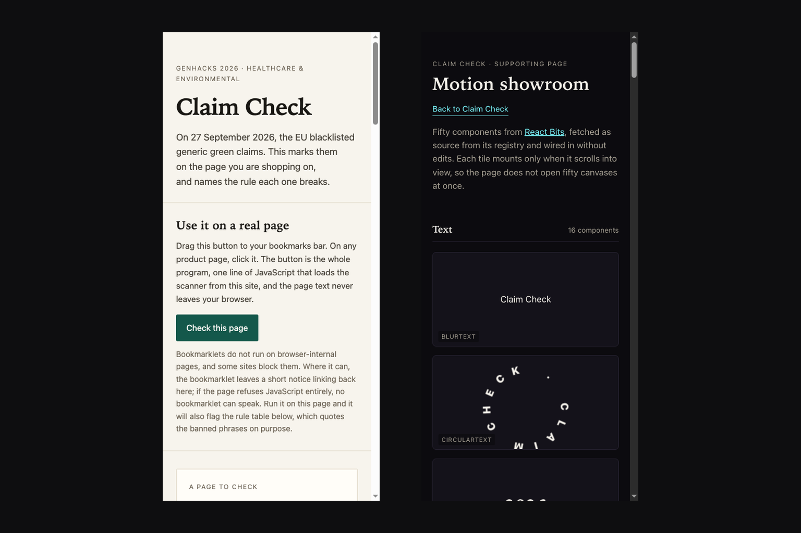

# Devpost: paste-in copy for the public project page

Every field on the Devpost form, filled in. The story is a fenced Markdown block so the `##` headings survive a copy and paste; the tags are one line for the tag box. Deadline: 26 December 2026, 12:00am EST.

## Project name

Claim Check

## Elevator pitch (164 characters)

> Claim Check marks the environmental claims that EU Directive 2024/825 now bans, right on the product page you're shopping on, and names the article each one breaks.

## Project story

Paste into **About the project**. It answers each prompt the form lists, in the form's order.

```markdown
## Inspiration

On 27 September 2026, Directive (EU) 2024/825 blacklisted generic environmental claims across the EU: "eco-friendly", "climate neutral", "biodegradable", the word "green" used as a product claim, and others. The ban applies to stock already on shelves. The law is specific about the words, but a shopper standing on a product page has no practical way to check them.

We wanted the check to happen where the claim is, not on another website. That meant a bookmarklet, a client-side scan, and a panel that quotes the sentence and the article instead of producing a vague score. No account, no extension, no upload.

## What it does

Claim Check reads the visible text of a product page in the browser and lists the claims that match the directive. Each finding shows:

- the surrounding sentence, with the matched phrase marked;
- the plain-English rule it breaks;
- the Annex I point or article, and the evidence that would make the claim lawful.

The demo page runs the same scanner on a synthetic product card and shows 4 banned claims and 2 claims needing evidence. A bookmarklet runs it on any live product page. Nothing is uploaded: the page text stays in the browser, including on a checkout page.

The rule set has six rules: four banned practices (a generic claim, the same promise in other words, "green" as a product claim, a neutrality claim resting on offsets) and two that need evidence (a future promise with no published plan, a sustainability label with no named scheme).

## How we built it

The scanner is pure JavaScript: text in, findings out, no DOM and no network. Page text comes through one contract with two adapters, one for a live DOM and one for saved HTML, so the bookmarklet and the offline corpus cannot disagree about what counts as page text. Both adapters share one skip definition, so regions marked `data-scan-skip` are ignored by both.

The rules are data in `src/rules.js`: pattern, citation, plain-English reading, and the evidence that would satisfy it. The demo and the bookmarklet share the same renderer logic through small separate entry points; the panel is mounted in a shadow root so a shop's CSS cannot restyle or break it.

The claim that this is not a keyword grep is machine-checked. The Recital 9 and Recital 12 sentences are vendored in `src/recitals.js`; the test parses the quoted examples out of that text and fails if a rule claims a phrase the directive does not contain, or if the directive names a phrase no rule covers. There are 55 assertions, including ordinary uses of the same words ("green tea", "green beans", "ecosystem") that must stay quiet.

We also ran the scanner over a fixed, dated sample of 13 saved product pages: 10 shop pages and 3 EU Ecolabel pages kept as a false-positive control. Ten shop pages produced no findings; all three certified pages carried "Biodegradable formula", which Recital 9 names and which the sentence does not substantiate. All three findings were reviewed in context and judged true positives. That is a 23.1% page hit rate and 0 of 3 reviewed false positives. The sample is a pilot, not a survey: it is small, brand-skewed, and six of the ten shop pages are US pages outside the directive's jurisdiction. The report states that limit itself.

The repo also contains a 50-component React Bits motion showroom, built for the visual side of the submission. The checker does not depend on it.

## Challenges we ran into

- **Bookmarklets and CSP.** Some shops block injected module scripts. The bookmarklet now leaves a short notice linking back to the demo instead of failing silently. A policy that blocks `javascript:` URLs outright stops any bookmarklet, which no page can work around.
- **One definition of page text.** The browser and the saved-page reader had to agree on hidden text, nested skip regions, self-closing tags and entities. Cross-adapter tests and a shared skip definition keep them aligned.
- **Not over-flagging.** "Green" is an ordinary word. The rule only fires when it is attached to a product, purchase or company, and the tests hold the line on tea, beans, greenhouse gas and ecosystems.
- **The certification control backfired in a useful way.** We expected the EU Ecolabel pages to read cleanly. They did not. A certification badge did not stop the generic wording, which is itself a finding.

## Accomplishments that we're proud of

- A finding is arguable in public: it shows the sentence, the exact phrase and the citation.
- The directive's own recital text is the source of truth for the phrase list, and the test enforces both directions.
- The scanner is dependency-free, works offline over saved HTML, and runs on a live page without a backend or an API key.
- The corpus is dated, hashed and honest about what 13 pages can support.

## What we learned

A legal rule can be a better product constraint than a model. Because the directive names the phrases and the citations, the hard part is not classification; it is reading the page the way a person does, showing enough context to be challengeable, and refusing to flag ordinary language.

We also learned that a small sample can reverse an assumption. The certified pages were meant to be the clean control; they became the only pages with findings.

## What's next for Claim Check

- A larger, pre-registered corpus (100 to 200 pages) across more EU shops and languages.
- A rule editor so a lawyer can add a phrase without touching code.
- Image and badge text, which a text scanner cannot see.
- Localisation for the languages the directive will be enforced in.

## Try it

Live demo: https://divitgangrade-lab.github.io/GenHacks---Divit/

Drag **Check this page** from the demo to the bookmarks bar, open a product page, and click it. The repo's README has a five-step testing path.

Source: https://github.com/divitgangrade-lab/GenHacks---Divit

The code and this copy were written with AI assistance (Freebuff). Every statement about the directive is checked against its text by the test suite, and the legal page lists the limits of the project as a compliance tool.
```

## Built with

Fourteen tags, all things the repo actually contains:

```
JavaScript, HTML5, CSS3, ES Modules, Shadow DOM, Node.js, GitHub Pages, Vite, React, React Bits, GSAP, Motion, OGL, use-gesture
```

The checker itself uses only the first five. Node.js is the test runner and the corpus script. Vite, React, React Bits, GSAP, Motion, OGL and use-gesture belong to the separate 50-component showroom.

## Try it out links

| Label on the page | URL |
|---|---|
| Live demo | https://divitgangrade-lab.github.io/GenHacks---Divit/ |
| Source code | https://github.com/divitgangrade-lab/GenHacks---Divit |
| 50-component motion showroom | https://divitgangrade-lab.github.io/GenHacks---Divit/motion/ |

## Project media (image gallery)

Four images, all 1536×1024 (exactly 3:2, under 5 MB), captured from the live Pages site on 21 November 2026. Upload in this order; the first is the thumbnail.

| File | What it shows |
|---|---|
| `devpost/01-demo.png` | The demo page: title, the drag-to-bookmarks install step, and the first two findings. |
| `devpost/02-findings.png` | The core proof: 4 banned claims and 2 needing evidence, each with the full sentence, one marked phrase, the rule and its Annex I citation. |
| `devpost/03-showroom.png` | The 50-component React Bits showroom, Text section. |
| `devpost/04-mobile.png` | The demo and the showroom at a 390 px viewport, side by side. |









## Video demo link

**Rendered, not yet uploaded.** `claim-check-film/claim-check.mp4` — 1:56, 3840×2160, 30 fps, −13.9 LUFS, 152 MB. Poster: `claim-check-film/poster.jpg`. Sidecar captions: `claim-check-film/subtitles_en.srt` (the same lines are burned into the picture).

Devpost embeds a YouTube or Vimeo URL, so this file still has to be uploaded from your account and its URL pasted into the field. Upload `claim-check.mp4` as-is — no re-encode needed — and use:

> Claim Check — the claim, the sentence, the article (GenHacks 2026)

What it contains, in order: the banned sentence and its stamp; the title; Directive 2024/825 and its date; the three words it names first; the demo page as an exhibit; one finding opened into sentence, rule and citation; the six rules; the green-tea decoy; the bookmarklet install; the privacy promise; the dated 13-page run with its limits; what the tool will not do; the end card with both URLs.

The shot list this film replaced is in [SUBMISSION.md](SUBMISSION.md#demo-video-shot-list-230-target-200245-acceptable); the direction, the frame-by-frame board, the review and the critique are in [`claim-check-film/`](claim-check-film/).

## Before submitting

- [ ] Video uploaded to YouTube or Vimeo and its URL pasted above.
- [ ] Four gallery images uploaded in the order listed.
- [ ] **Healthcare & Environmental** selected as the track.
- [ ] Repo and demo links opened once from a logged-out browser.
